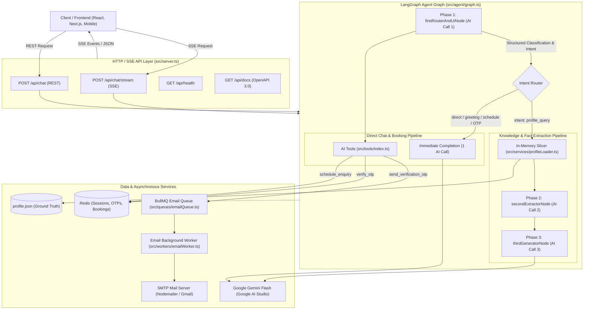

# System Architecture Specification

## AI Agent Backend (Yoho for Vyshnav P C)

This document provides a comprehensive technical overview of the architecture, design principles, data flow, agent graph, security mechanisms, and integration interfaces for the AI Agent backend.

---

## 1. High-Level Architectural Overview

The backend is built as an event-driven, multi-agent AI system on top of **Node.js / TypeScript**, **LangGraph.js**, **Google Gemini Flash** (`gemini-flash-lite-latest` via Google AI Studio), **In-Memory Structured Profile Slicing** (`src/data/profile.json`), **Redis**, and **BullMQ**.

It serves two primary roles:
1. **Portfolio Knowledge Assistant**: Answers questions strictly grounded in Vyshnav's background, technical stack, featured projects ([Domain Scanner](https://domainscanner.vyshnavpc.com) and [YohoAiAgent](https://github.com/vyshn4v/YohoAiAgent)), and career history (with **strictly no web searching**, clean plain text, zero HTML tags, and zero unsolicited wrap-ups or tips).
2. **Consultation & Meeting Booking Engine**: Dynamically collects visitor details, secures bookings via 6-digit cryptographic email OTPs, enforces a **24-hour SLA commitment**, and renders generative interactive UI widgets on the frontend.

### Component Topology



---

## 2. Multi-Agent LangGraph State Machine

The core intelligence is modeled as a stateful computational graph using **LangGraph.js** ([src/agent/graph.ts](../src/agent/graph.ts)).

### Execution Flow & Token Optimization
The pipeline is designed with a **3-tier architecture** to minimize token consumption and maximize response speed:

1. **Phase 1: Router, Direct Chat & UI Actions (`firstRouterAndUiNode`)**
   - Natural language intent extraction: detects user contact info (`name`, `email`, `phone`, `reason`), OTP codes, or intent.
   - For greetings, general conversation, or UI events (OTP verification, contact collection, booking confirmation), it generates the final response **immediately in Phase 1 (1 single AI call)**, bypassing subsequent stages and saving tokens.
   - For knowledge queries about Vyshnav, it classifies the target categories (e.g., `['experience']`, `['projects']`, `['skills']`) and routes to Phase 2.

2. **Phase 2: In-Memory Profile Slicing & Fact Extraction (`secondExtractorNode`)**
   - **Zero-Token Profile Slicing**: Slices only the required category from [src/data/profile.json](../src/data/profile.json) in-memory in `0ms` with zero AI tokens.
   - Sends the sliced JSON and user query to Google Gemini with a structured schema (`relevantFacts: string[]`, `found: boolean`), isolating strictly verified facts and preventing hallucination.

3. **Phase 3: Final Response Synthesizer (`thirdGeneratorNode`)**
   - Synthesizes the extracted facts into a natural, friendly answer in the persona of **Yoho**.
   - **Strict Formatting Guardrails**: Clean plain text with standard `-` bullets, zero HTML tags (`<br>`, `<table>`, etc.), and zero unsolicited wrap-ups or tips at the end.

### State Schema (`AgentStateType`)

```typescript
export interface AgentStateType {
  messages: BaseMessage[];              // Conversational history
  intent?: 'profile_query' | 'schedule_enquiry' | 'general_chat' | 'direct';
  categories?: string[];                // Target keys for profile.json slicing
  slicedData?: Record<string, any>;     // In-memory sliced JSON payload
  relevantFacts?: string[];             // Factual bullet points extracted by Phase 2
  retrievedDocs?: RetrievedDocument[];  // Structured doc slices
  leadInfo?: LeadInfo;                  // Captured visitor contact details across turns
  isVerified?: boolean;                 // Email OTP verification status
  uiAction?: UiAction | null;           // Generative UI action descriptor
  finalMessage?: string;                // Final synthesized plain-text response
}
```

### Node Responsibilities

| Node Name | File | Primary Responsibility | Model / Engine |
| :--- | :--- | :--- | :--- |
| **`firstRouterAndUiNode`** | [nodes.ts](../src/agent/nodes.ts) | Classifies intent, extracts contact details & OTP codes, handles UI events, and resolves direct chats in 1 AI call. | Google Gemini Flash |
| **`secondExtractorNode`** | [nodes.ts](../src/agent/nodes.ts) | Slices `profile.json` in-memory and extracts relevant factual bullets via structured output. | Google Gemini Flash |
| **`thirdGeneratorNode`** | [nodes.ts](../src/agent/nodes.ts) | Synthesizes final plain-text response as Yoho without HTML tags or unsolicited concluding tips. | Google Gemini Flash |

---

## 3. Ground Truth Data Architecture (`profile.json`)

To ensure 100% deterministic, zero-hallucination answers without vector embedding drifts or token overhead:
- All portfolio records are centralized in **[src/data/profile.json](../src/data/profile.json)** (and mirrored at `data/profile.json`).
- `src/services/profileLoader.ts` provides typed in-memory access to:
  - `personal`: Bio, core philosophy, key metrics, location, availability.
  - `skills`: Core stack, Generative AI, backend architecture, databases, messaging, cloud/DevOps.
  - `experience`: SDE-I at Neutrinos, Sunlife Philippines, 1,000–2,000 req/min decision engine, awards.
  - `projects`: Detailed specs for **Domain Scanner** and **YohoAiAgent**.
  - `agency`: LixerLab digital agency services.
  - `engineeringPhilosophy`: The 4 engineering pillars (Lifecycle Ownership, Throughput & Scale, Decoupled Systems, Code Correctness).
  - `certifications`, `education`, `languages`, and `schedulingPolicy`.

> [!NOTE]
> `profile.md` is deprecated and no longer required; `profile.json` is the sole source of truth.

---

## 4. Generative UI Action Architecture

The AI model autonomously determines when to trigger interactive client-side components:

### The Tool-Driven UI Flow


### Supported UI Action Descriptors

1. **`form_input`**: Emitted when the user wants to schedule or connect but has not provided name and email.
2. **`otp_input`**: Emitted immediately upon generating and dispatching an email OTP.

---

## 5. Security & Cryptographic Verification Engine

- **Cryptographic Random Generation**: OTPs are generated using Node's `crypto.randomInt(100000, 1000000)`.
- **Zero Plaintext Storage**: Redis never stores OTPs in plain text. Every OTP is hashed with `SHA-256` prior to persistence (`otp:${email}`).
- **Constant-Time Verification**: Verification uses `crypto.timingSafeEqual(storedHash, providedHash)` to prevent timing side-channel attacks.
- **Brute-Force Rate Limiting**: Max 3 verification attempts per OTP. On the 3rd failed attempt, the key is evicted immediately.
- **Auto-Expiration TTL**: Unverified OTPs expire automatically after 10 minutes (`EX 600`).
- **Idempotent Background Dispatch**: BullMQ handles outbound email delivery asynchronously with exponential backoff (`attempts: 3`, `backoff: { type: 'exponential', delay: 2000 }`), decoupling user-facing HTTP latency from SMTP server response times.

---

## 6. Server-Sent Events (SSE) Streaming Protocol

Real-time streaming is implemented via `POST /api/chat/stream` and `GET /api/chat/stream`.

### Event Lifecycle


---

## 7. Configuration & Multi-Provider Architecture

The agent supports automatic routing across multiple LLM providers configured via environment variables:

- **Primary Provider**: Google Gemini Flash (`gemini-flash-lite-latest` via Google AI Studio).
- **Alternative Providers**: Groq (`openai/gpt-oss-120b`), NVIDIA NIM (`nvidia/nemotron-3.5-lightning-30b-a3b`), and OpenRouter (`openrouter/free`).
- **Token Configuration**: `maxTokens: 2048` configured in `src/agent/nodes.ts` to ensure detailed profile and work experience responses are rendered fully without truncation.

---

## 8. Directory & File Reference

- [src/server.ts](../src/server.ts) — Express REST & SSE streaming server.
- [src/agent/graph.ts](../src/agent/graph.ts) — LangGraph state graph compilation and routing.
- [src/agent/nodes.ts](../src/agent/nodes.ts) — Graph nodes (`firstRouterAndUiNode`, `secondExtractorNode`, `thirdGeneratorNode`).
- [src/agent/state.ts](../src/agent/state.ts) — TypeScript state channel schemas.
- [src/data/profile.json](../src/data/profile.json) — Ground-truth structured portfolio database.
- [src/services/profileLoader.ts](../src/services/profileLoader.ts) — Typed in-memory profile JSON loader and category slicer.
- [src/tools/index.ts](../src/tools/index.ts) — AI tools and generative UI action definitions.
- [src/services/otpService.ts](../src/services/otpService.ts) — Cryptographic OTP generation, hashing, and verification.
- [src/services/redisClient.ts](../src/services/redisClient.ts) — Redis client connection and key utilities.
- [src/queues/emailQueue.ts](../src/queues/emailQueue.ts) — BullMQ email queue producer.
- [src/workers/emailWorker.ts](../src/workers/emailWorker.ts) — BullMQ background worker with Nodemailer SMTP.
- [docs/FRONTEND_INTEGRATION_GUIDE.md](FRONTEND_INTEGRATION_GUIDE.md) — Comprehensive frontend SSE integration guide with React/Next.js code.
