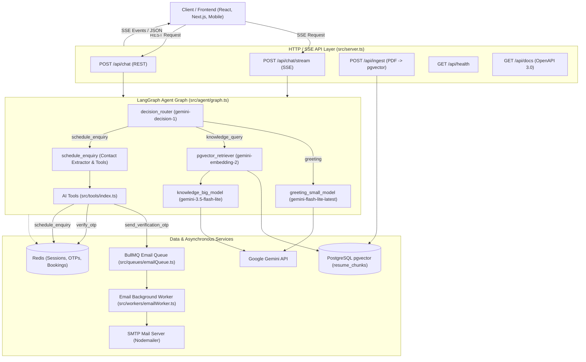
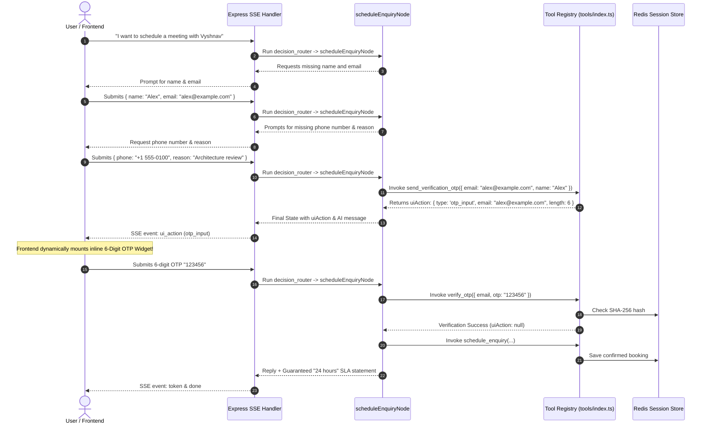

# System Architecture Specification

## AI Agent Backend (Yoho for Vyshnav P C)

This document provides a comprehensive technical overview of the architecture, design principles, data flow, agent graph, security mechanisms, and integration interfaces for the AI Agent backend.

---

## 1. High-Level Architectural Overview

The backend is built as an event-driven, multi-agent AI system on top of **Node.js / TypeScript**, **LangGraph.js**, **Google Gemini** (`gemini-decision-1`, `gemini-flash-lite-latest`, `gemini-3.5-flash-lite`, `gemini-embedding-2`), **PostgreSQL (`pgvector`)**, **Redis**, and **BullMQ**.

It serves two primary roles:
1. **Portfolio Knowledge Assistant**: Answers questions strictly grounded in resume chunks stored in PostgreSQL `pgvector` (`resume_chunks`), returning deterministic scope guardrails for unrelated queries.
2. **Consultation & Meeting Booking Engine**: Dynamically collects visitor details, secures bookings via 6-digit cryptographic email OTPs, enforces a **24-hour SLA commitment**, and emits generative interactive UI widgets for the frontend.

### Component Topology



---

## 2. Multi-Agent LangGraph State Machine

The core intelligence is modeled as a stateful computational graph using **LangGraph.js** ([src/agent/graph.ts](../src/agent/graph.ts)).

### Execution Flow & Routing
1. **Decision Router (`decision_router`)**: Uses `gemini-decision-1` with recent assistant context (`buildDecisionInput`) to classify messages into `greeting`, `schedule_enquiry`, `knowledge_query` (`profile_query`), or `out_of_scope` (returns deterministic boundary message directly to `END`).
2. **Greeting Node (`greeting_small_model`)**: Handles greetings fast without hitting PostgreSQL.
3. **PostgreSQL Vector Retriever (`pgvector_retriever`)**: Embeds the query via `generateTextEmbedding` and runs cosine similarity search (`searchResumeChunks`) strictly against `resume_chunks` in PostgreSQL.
4. **Knowledge Synthesizer (`knowledge_big_model`)**: Generates concise answers grounded strictly in retrieved `pgvector` chunks (returning an empty-context fallback prompt if no chunks exist).
5. **Schedule Enquiry (`schedule_enquiry`)**: Extracts `name`, `email`, `phone`, `reason`, and `otp`, dispatching verification emails and persisting confirmed leads in Redis.

### State Schema (`AgentStateType`)

```typescript
export interface AgentStateType {
  messages: BaseMessage[];              // Conversational history
  intent?: 'greeting' | 'profile_query' | 'schedule_enquiry' | 'direct' | 'out_of_scope' | string;
  finalMessage?: string;                // Final plain-text reply
  extractedKeywords?: string;           // Search query for pgvector
  retrievedDocs?: RetrievedDocument[];  // Retrieved pgvector resume chunks
  leadInfo?: LeadInfo;                  // Captured visitor contact details across turns
  isVerified?: boolean;                 // Email OTP verification status
  uiAction?: Record<string, any> | null;// Generative UI action descriptor
}
```

### Node Responsibilities

| Node Name | File | Primary Responsibility | Model / Engine |
| :--- | :--- | :--- | :--- |
| **`decisionRouterNode`** | [decisionRouterNode.ts](../src/agent/nodes/decisionRouterNode.ts) | Classifies user intent with prior assistant context and handles `out_of_scope` cutoffs. | `gemini-decision-1` |
| **`greetingSmallModelNode`** | [greetingNode.ts](../src/agent/nodes/greetingNode.ts) | Responds warmly to greetings with zero DB lookup. | `gemini-flash-lite-latest` |
| **`pgVectorRetrieverNode`** | [pgVectorRetrieverNode.ts](../src/agent/nodes/pgVectorRetrieverNode.ts) | Embeds query text and retrieves top chunks from PostgreSQL `resume_chunks`. | `gemini-embedding-2` + PostgreSQL |
| **`bigModelKnowledgeNode`** | [knowledgeNode.ts](../src/agent/nodes/knowledgeNode.ts) | Synthesizes grounded answers strictly from retrieved chunks. | `gemini-3.5-flash-lite` |
| **`scheduleEnquiryNode`** | [scheduleEnquiryNode.ts](../src/agent/nodes/scheduleEnquiryNode.ts) | Extracts lead fields/OTP and calls OTP & booking tools. | `gemini-flash-lite-latest` |

---

## 3. PostgreSQL `pgvector` Knowledge Storage

Portfolio knowledge is indexed from a resume PDF via [ingestResumePdf.ts](../src/scripts/ingestResumePdf.ts) (`npm run ingest:pdf` or `POST /api/ingest`) and stored exclusively in the PostgreSQL `resume_chunks` table managed by [pgVectorService.ts](../src/services/pgVectorService.ts) (with cosine similarity HNSW indexing).

---

## 4. Generative UI Action Architecture

The AI model autonomously determines when to trigger interactive client-side components:

### The Tool-Driven UI Flow



### Supported UI Action Descriptors

1. **`otp_input`**: Emitted immediately upon generating and dispatching an email OTP.

---

## 5. Security & Cryptographic Verification Engine

- **Cryptographic Random Generation**: OTPs are generated using Node's `crypto.randomInt(100000, 1000000)`.
- **Zero Plaintext Storage**: Redis never stores OTPs in plain text. Every OTP is hashed with `SHA-256` prior to persistence (`otp:${email}`).
- **Constant-Time Verification**: Verification uses `crypto.timingSafeEqual(storedHash, providedHash)` to prevent timing side-channel attacks.
- **Brute-Force Rate Limiting**: Max 3 verification attempts per OTP. On the 3rd failed attempt, the key is evicted immediately.
- **Auto-Expiration TTL**: Unverified OTPs expire automatically after 10 minutes (`EX 600`).
- **Idempotent Background Dispatch**: BullMQ handles outbound email delivery asynchronously with exponential backoff (`attempts: 3`, `backoff: { type: 'exponential', delay: 2000 }`), decoupling user-facing HTTP latency from SMTP server response times.

---

## 6. Server-Sent Events (SSE) Streaming Protocol

Real-time streaming is implemented via `POST /api/chat/stream` and `GET /api/chat/stream`.

### Event Lifecycle


---

## 7. Configuration & Multi-Provider Architecture

The agent supports automatic routing across multiple LLM providers configured via environment variables:

- **Primary Provider**: Google Gemini (`gemini-decision-1`, `gemini-flash-lite-latest`, `gemini-3.5-flash-lite`, `gemini-embedding-2` via Google AI Studio).
- **Alternative Providers**: Groq (`openai/gpt-oss-120b`), NVIDIA NIM (`nvidia/nemotron-3.5-lightning-30b-a3b`), and OpenRouter (`openrouter/free`).
- **Token Configuration**: `maxTokens: 2048` configured in `src/agent/llm/modelFactory.ts` to ensure detailed responses render without truncation.

---

## 8. Directory & File Reference

- [src/server.ts](../src/server.ts) — Express REST & SSE streaming server.
- [src/http/routes/chatRoutes.ts](../src/http/routes/chatRoutes.ts) & [systemRoutes.ts](../src/http/routes/systemRoutes.ts) — Chat, health, ingest, docs, and enquiries routes.
- [src/agent/graph.ts](../src/agent/graph.ts) — LangGraph state graph compilation and routing.
- [src/agent/nodes.ts](../src/agent/nodes.ts) & `src/agent/nodes/*` — Modular LangGraph nodes (`decisionRouterNode`, `greetingSmallModelNode`, `pgVectorRetrieverNode`, `bigModelKnowledgeNode`, `scheduleEnquiryNode`).
- [src/agent/state.ts](../src/agent/state.ts) — TypeScript state channel schemas.
- [src/services/pgVectorService.ts](../src/services/pgVectorService.ts) & [embeddingService.ts](../src/services/embeddingService.ts) — PostgreSQL `pgvector` search/storage and vector embeddings.
- [src/scripts/ingestResumePdf.ts](../src/scripts/ingestResumePdf.ts) — Resume PDF chunker and PostgreSQL `pgvector` indexer.
- [src/tools/index.ts](../src/tools/index.ts) — AI tools and generative UI action definitions.
- [src/services/otpService.ts](../src/services/otpService.ts) — Cryptographic OTP generation, hashing, and verification.
- [src/services/redisClient.ts](../src/services/redisClient.ts) — Redis client connection and key utilities.
- [src/queues/emailQueue.ts](../src/queues/emailQueue.ts) — BullMQ email queue producer.
- [src/workers/emailWorker.ts](../src/workers/emailWorker.ts) & [emailTemplates.ts](../src/workers/emailTemplates.ts) — BullMQ background worker and HTML-escaped email templates.
- [docs/FRONTEND_INTEGRATION_GUIDE.md](FRONTEND_INTEGRATION_GUIDE.md) — Comprehensive frontend SSE integration guide with React/Next.js code.
