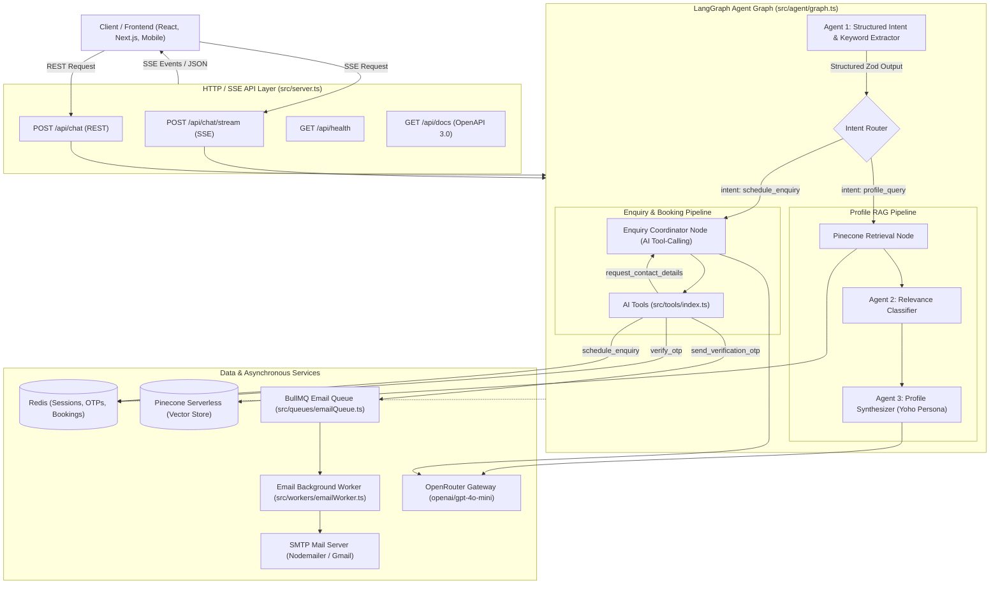
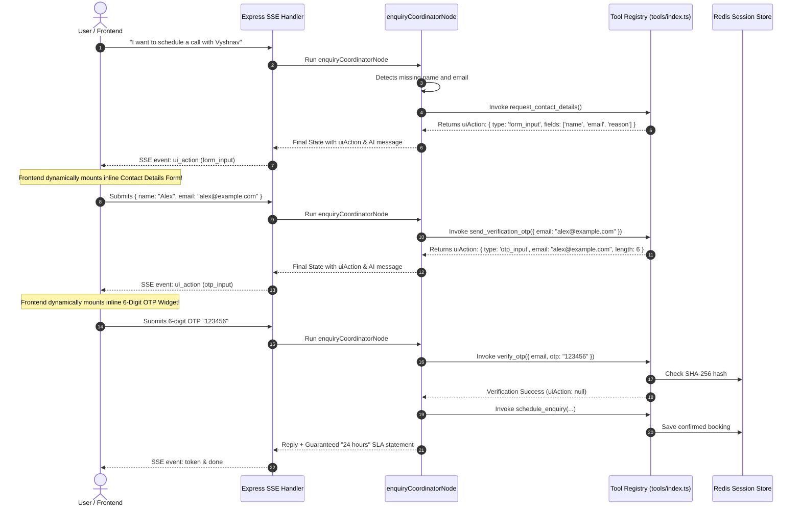
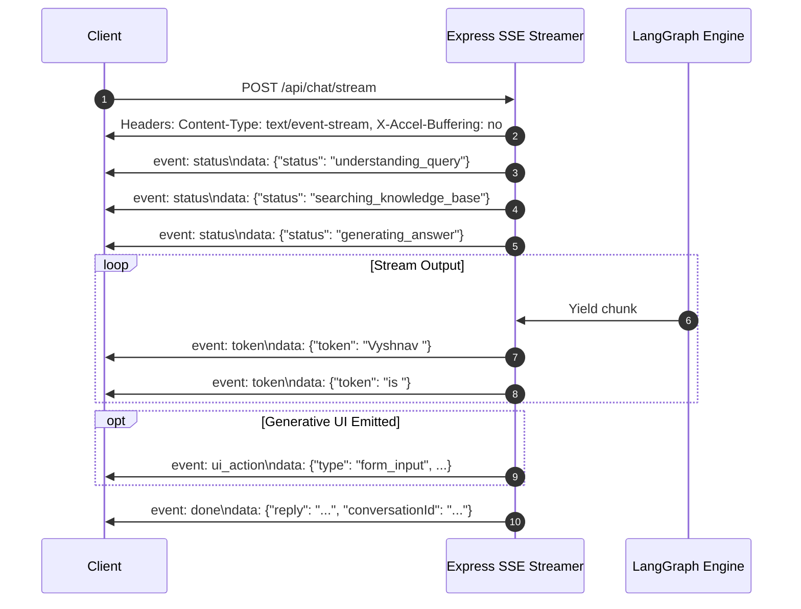

# System Architecture Specification

## AI Agent Backend (Yoho for Vyshnav P C)

This document provides a comprehensive technical overview of the architecture, design principles, data flow, agent graph, security mechanisms, and integration interfaces for the AI Agent backend.

---

## 1. High-Level Architectural Overview

The backend is built as an event-driven, multi-agent AI system on top of **Node.js / TypeScript**, **LangGraph.js**, **OpenRouter (`openai/gpt-4o-mini`)**, **Pinecone Vector Database**, **Redis**, and **BullMQ**.

It serves two primary roles:
1. **Portfolio RAG Assistant**: Answers questions strictly grounded in Vyshnav's background, technical stack, featured projects, and career history (with **strictly no web searching**).
2. **Consultation & Meeting Booking Engine**: Dynamically collects visitor details, secures bookings via 6-digit cryptographic email OTPs, enforces a **24-hour SLA commitment**, and renders generative interactive UI widgets on the frontend.

### Component Topology



---

## 2. Multi-Agent LangGraph State Machine

The core intelligence is modeled as a stateful computational graph using **LangGraph.js** (`src/agent/graph.ts`).

### State Schema (`AgentState`)

```typescript
export interface AgentState {
  messages: BaseMessage[];              // Full conversational history
  intent?: 'profile_query' | 'schedule_enquiry'; // Extracted intent
  keywords?: string[];                 // Search queries for vector retrieval
  retrievedDocs?: Document[];          // Chunks fetched from Pinecone or local profile
  filteredDocs?: Document[];           // Chunks validated by Agent 2
  leadInfo?: {                         // Captured contact info across turns
    name?: string;
    email?: string;
    phone?: string;
    reason?: string;
    preferredDate?: string;
    preferredTime?: string;
  };
  isVerified?: boolean;                // Email OTP verification status
  uiAction?: {                         // Generative UI action payload
    type: 'form_input' | 'otp_input';
    title?: string;
    description?: string;
    email?: string;
    fields?: Array<{ name: string; type: string; label: string; required: boolean }>;
    error?: string;
  } | null;
}
```

### Node Responsibilities

| Node Name | File | Primary Responsibility | Model / Engine |
| :--- | :--- | :--- | :--- |
| **`agent1KeywordExtractor`** | [nodes.ts](../src/agent/nodes.ts) | Classifies intent into `profile_query` or `schedule_enquiry` and extracts semantic keywords. Uses `llm.withStructuredOutput(intentSchema)` to guarantee 100% JSON validity with zero text hallucinations. | GPT-4o-mini |
| **`pineconeRetrievalNode`** | [nodes.ts](../src/agent/nodes.ts) | Converts extracted keywords into vector queries and retrieves top-$k$ relevant chunks from Pinecone. Gracefully falls back to local `src/data/profile.md` if Pinecone is unconfigured. | `text-embedding-3-small` / Pinecone |
| **`agent2RelevanceClassifier`** | [nodes.ts](../src/agent/nodes.ts) | Evaluates retrieved chunks against user intent to strip false-positive vector matches before synthesis. | GPT-4o-mini |
| **`agent3ProfileSynthesizer`** | [nodes.ts](../src/agent/nodes.ts) | Synthesizes friendly, concise portfolio answers strictly using validated chunks. Persona: **Yoho**. Web search is disabled and forbidden. | GPT-4o-mini |
| **`enquiryCoordinatorNode`** | [nodes.ts](../src/agent/nodes.ts) | Multi-turn booking coordinator. Evaluates user messages with native AI tool-calling to collect details, issue OTPs, verify OTPs, and book consultations. Enforces mandatory 24h SLA. | GPT-4o-mini (Tool Calling) |

---

## 3. Generative UI Action Architecture

To deliver an exceptional user experience, the backend does not rely on rigid if-else conditional ladders. Instead, **the AI model autonomously decides when to trigger client-side interactive UI components**.

### The Tool-Driven UI Flow



### Supported UI Action Descriptors

1. **`form_input`**: Emitted when the user expresses an intent to connect but hasn't provided contact details.
   ```json
   {
     "type": "form_input",
     "title": "Enter Your Details",
     "fields": [
       { "name": "name", "type": "text", "label": "Full Name", "required": true },
       { "name": "email", "type": "email", "label": "Email Address", "required": true },
       { "name": "reason", "type": "text", "label": "Purpose / Note", "required": false }
     ]
   }
   ```
2. **`otp_input`**: Emitted immediately upon generating and dispatching an email OTP.
   ```json
   {
     "type": "otp_input",
     "title": "Enter Verification Code",
     "description": "A 6-digit verification code was sent to alex@example.com.",
     "email": "alex@example.com",
     "length": 6,
     "placeholder": "123456"
   }
   ```

---

## 4. Security & Cryptographic Verification Engine

Meeting scheduling requires email ownership verification to prevent spam and identity spoofing.

### Security Highlights
- **Cryptographic Random Generation**: OTPs are generated using Node's `crypto.randomInt(100000, 1000000)`.
- **Zero Plaintext Storage**: Redis never stores OTPs in plain text. Every OTP is hashed with `SHA-256` prior to persistence (`otp:${email}`).
- **Constant-Time Verification**: Verification uses `crypto.timingSafeEqual(storedHash, providedHash)` to prevent timing side-channel attacks.
- **Brute-Force Rate Limiting**: Max 3 verification attempts per OTP. On the 3rd failed attempt, the key is evicted immediately.
- **Auto-Expiration TTL**: Unverified OTPs expire automatically after 10 minutes (`EX 600`).
- **Idempotent Background Dispatch**: BullMQ handles outbound email delivery asynchronously with exponential backoff (`attempts: 3`, `backoff: { type: 'exponential', delay: 2000 }`), decoupling user-facing HTTP latency from SMTP server response times.

---

## 5. Server-Sent Events (SSE) Streaming Protocol

Real-time streaming is implemented via `POST /api/chat/stream` and `GET /api/chat/stream`.

### Event Lifecycle



### Frontend Streaming Rules
1. **Chat Input Remains Always Interactive**:
   The chat text `<input>` or `<textarea>` must **never** be disabled during streaming. The user should be able to continue typing their next message without interruptions.
2. **Disable Only the Send Button**:
   Only the Send button (`disabled={isStreaming || !input.trim()}`) and the Enter-key trigger are locked while streaming is active.
3. **Lazy Message Creation**:
   The frontend must not render empty assistant bubbles or bot avatars during the initial status events. It only instantiates the assistant message when the first `event: token` or `event: ui_action` arrives.

---

## 6. Vector Ingestion & Grounding Guardrails

### Knowledge Base Pipeline (`src/scripts/ingest.ts`)
1. Reads `src/data/profile.md` (containing Vyshnav's background, work history, projects, tech stack, and contact links).
2. Recursively splits text into overlapping semantic chunks (500 characters, 50 character overlap).
3. Generates vector embeddings via OpenAI `text-embedding-3-small` (1536 dimensions).
4. Upserts records into Pinecone Serverless Index with metadata (`source`, `text`, `section`).

### Guardrails
- **Strictly Grounded**: Agent 3's prompt explicitly instructs: *"You are Yoho, an AI assistant for Vyshnav P C. You must answer questions ONLY using the retrieved context. Never assume or fabricate details. Web searching is strictly prohibited."*
- **Mandatory SLA Commitment**: Any meeting booking response is automatically audited by the coordinator to ensure the exact phrase *"Vyshnav will personally get in touch within 24 hours"* is present before returning to the user.

---

## 7. Reliability, Budget Optimization & Configuration

- **Token Reservation Control**: Configured with `maxTokens: 1000` across all OpenRouter model instances to prevent HTTP 402 ("Request requires more credits or fewer max_tokens") caused by default 16k token reservations on low balances.
- **Deterministic Testing**: Vitest test runner is configured with `--no-file-parallelism` to prevent concurrent API rate-limit spikes during test execution.
- **Resilience**: If Pinecone or Redis are unreachable, the service continues to operate with local profile fallback and in-memory session management.

---

## 8. Directory & File Reference

- [src/server.ts](../src/server.ts) — Express REST & SSE streaming server.
- [src/agent/graph.ts](../src/agent/graph.ts) — LangGraph state graph compilation and routing.
- [src/agent/nodes.ts](../src/agent/nodes.ts) — Graph nodes (Agent 1, Agent 2, Agent 3, Pinecone Retrieval, Coordinator).
- [src/agent/state.ts](../src/agent/state.ts) — TypeScript state channel schemas.
- [src/tools/index.ts](../src/tools/index.ts) — AI tools and generative UI action definitions.
- [src/services/otpService.ts](../src/services/otpService.ts) — Cryptographic OTP generation, hashing, and verification.
- [src/services/redisClient.ts](../src/services/redisClient.ts) — Redis client connection and key utilities.
- [src/services/pineconeService.ts](../src/services/pineconeService.ts) — Pinecone vector retrieval and fallback logic.
- [src/queues/emailQueue.ts](../src/queues/emailQueue.ts) — BullMQ email queue producer.
- [src/workers/emailWorker.ts](../src/workers/emailWorker.ts) — BullMQ background worker with Nodemailer SMTP.
- [docs/FRONTEND_INTEGRATION_GUIDE.md](FRONTEND_INTEGRATION_GUIDE.md) — Comprehensive frontend SSE integration guide with React/Next.js code.
